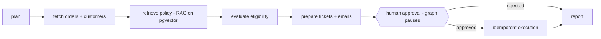

# NexusOps AI - Agentic Workflow Automation

An agentic workflow engine that turns a manager's natural-language request into an audited,
human-approved sequence of API actions.

> "Find customers whose orders are delayed, check our refund policy, create support tickets for
> eligible customers and email them."

Built with **Python, FastAPI, LangGraph, PostgreSQL + pgvector, Redis, Docker**.

## What it does



1. **Plan** - a planner turns the request into a validated Pydantic plan. A deterministic `RulePlanner`
   is the default; `GeminiPlanner` (optional, `GEMINI_API_KEY`) asks an LLM for JSON, validates it, and
   falls back to the rules if the call fails or the output is invalid.
2. **Integrate** - reads delayed orders and customers from a REST API (HTTPX, timeouts, bounded retries).
3. **RAG** - retrieves the applicable refund policy from PostgreSQL + pgvector (bge-small embeddings,
   metadata filter on policy kind, Redis cache) and cites its policy id in the report.
4. **Decide** - applies the retrieved thresholds; orders with invalid data, missing customers or policy
   exclusions are skipped with a recorded reason.
5. **Human approval** - the LangGraph run is *interrupted* and its state is checkpointed in PostgreSQL.
   Nothing touches an external system until a manager approves (all, some, or none of the orders).
6. **Execute** - creates tickets and notifications through an **action ledger** (unique per
   run + order + action) plus `Idempotency-Key` headers, so retries and crash recovery never duplicate work.
7. **Report** - success/failure per action, skipped orders with reasons, policies cited. Every step is
   written to an audit log and a per-node trace table (latency, token counts when an LLM is used).

## API

| Method | Endpoint | Purpose | Roles |
|---|---|---|---|
| POST | `/auth/token` | Log in, get a JWT | public |
| POST | `/auth/logout` | Revoke the session (Redis) | any |
| POST | `/agents/run` | Start a workflow; returns proposals awaiting approval | manager, admin |
| POST | `/runs/{id}/approve` | Approve / reject (atomic, second call -> 409) | manager, admin |
| GET | `/runs/{id}` | Run status and report | owner, admin |
| GET | `/runs/{id}/audit` | Audit trail | owner, admin |
| GET | `/runs/{id}/traces` | Per-node timings | owner, admin |
| GET | `/health` | Liveness (checks the DB) | public |

Swagger UI at `/docs`. Users only ever see their own runs (404, not 403, for others' ids).

## Run it

```bash
docker compose up --build            # app :8000, mock ERP, Postgres+pgvector, Redis
bash scripts/smoke_test.sh           # login -> run -> approval -> execute -> double-approve rejected
```

Demo accounts (`admin` / `manager` / `viewer`, passwords `<role>-demo`) are for local use only; change
them and `JWT_SECRET` for anything real.

Without Docker (tests use an embedded Postgres with pgvector, and fakeredis):

```bash
pip install -r requirements-dev.txt
python -m pytest -q --cov=app
python -m evaluations.run_eval
```

## Evaluation (measured, reproducible)

`evaluations/` holds 100 fault-injection scenarios (`workflow_scenarios.json`), generated with a fixed
seed together with expected outcomes from an oracle independent of the workflow code. The same 100
scenarios are run against three modes. A scenario passes only if the final status **and** the exact set
of tickets and notifications created in the mock ERP match the oracle (a duplicate fails it).

| Mode | Passed | Duplicate actions |
|---|---|---|
| naive (no retries, no idempotency, no checkpoints) | 55 / 100 | 27 |
| retry only | 75 / 100 | 96 |
| **full engine** | **100 / 100** | **0** |

| Category (n) | naive | retry only | full |
|---|---|---|---|
| normal (30) | 30 | 30 | 30 |
| transient API failures (20) | 0 | 20 | 20 |
| timeout after the server committed (15) | 0 | 0 | 15 |
| human rejection (10) | 10 | 10 | 10 |
| partial approval (5) | 5 | 5 | 5 |
| crash mid-execution, then recover (10) | 0 | 0 | 10 |
| invalid / missing data (5) | 5 | 5 | 5 |
| permanent API failure (5) | 5 | 5 | 5 |

Full engine workflow latency (in-process, includes checkpointing): p50 89.7 ms, p95 142.6 ms.
Details: [`evaluations/evaluation_report.md`](evaluations/evaluation_report.md),
raw numbers: [`evaluations/benchmark_results.json`](evaluations/benchmark_results.json).

**Tests:** 58 pytest tests, 93% line coverage of `app/` (`config.py` and `main.py`, which only read
environment variables and wire the app together, are not covered). They include authorization checks
(no token, viewer role, other users' runs, revoked and expired tokens, double approval), crash recovery
with a brand-new service instance, and duplicate-prevention under injected timeouts.

## Limitations (read before trusting the numbers)

- The benchmark is **synthetic**: an in-process mock ERP with injected faults. "naive" and "retry only" are
  weaker baselines written for this repo, not third-party systems. It measures workflow reliability, not
  how well an LLM understands requests.
- The default planner is rule-based. `GeminiPlanner` is unit-tested with mocked HTTP responses only; it has
  not been run against the live API in this repo, and no LLM accuracy or token cost is reported.
- Redis behaviour in tests/evaluation uses `fakeredis`; the compose stack uses a real Redis.
- Tracing is a Postgres `traces` table, not Langfuse.
- Docker Compose was not run on the author's machine (no Docker there); it is exercised by the
  `docker-smoke` CI job.
- Demo credentials and the mock ERP are not production components.

## Layout

```
app/          api, workflow (LangGraph), planner, policy_rag (pgvector), clients (retries), auth, cache, db
tests/        58 tests
evaluations/  scenarios.py (oracle), run_eval.py, results + report
scripts/      smoke_test.sh
```
